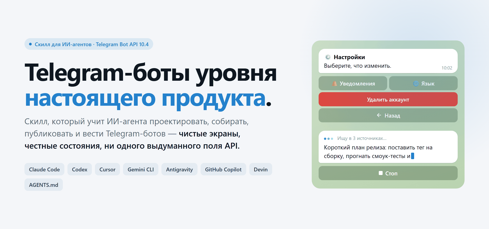
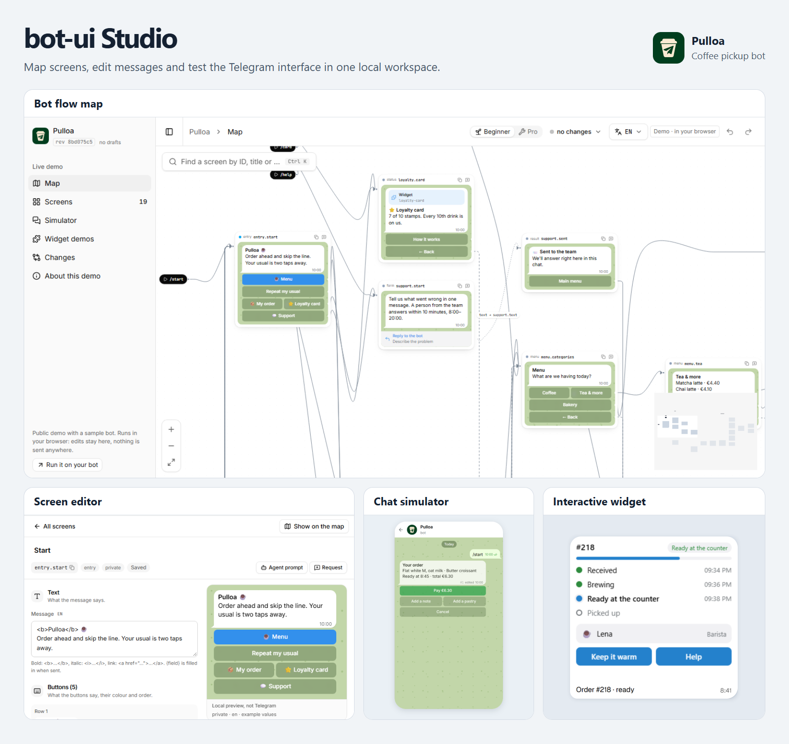
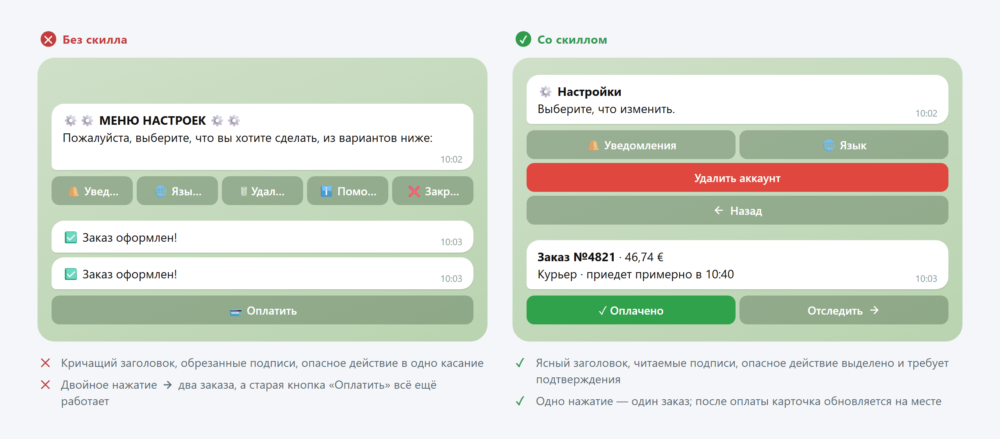
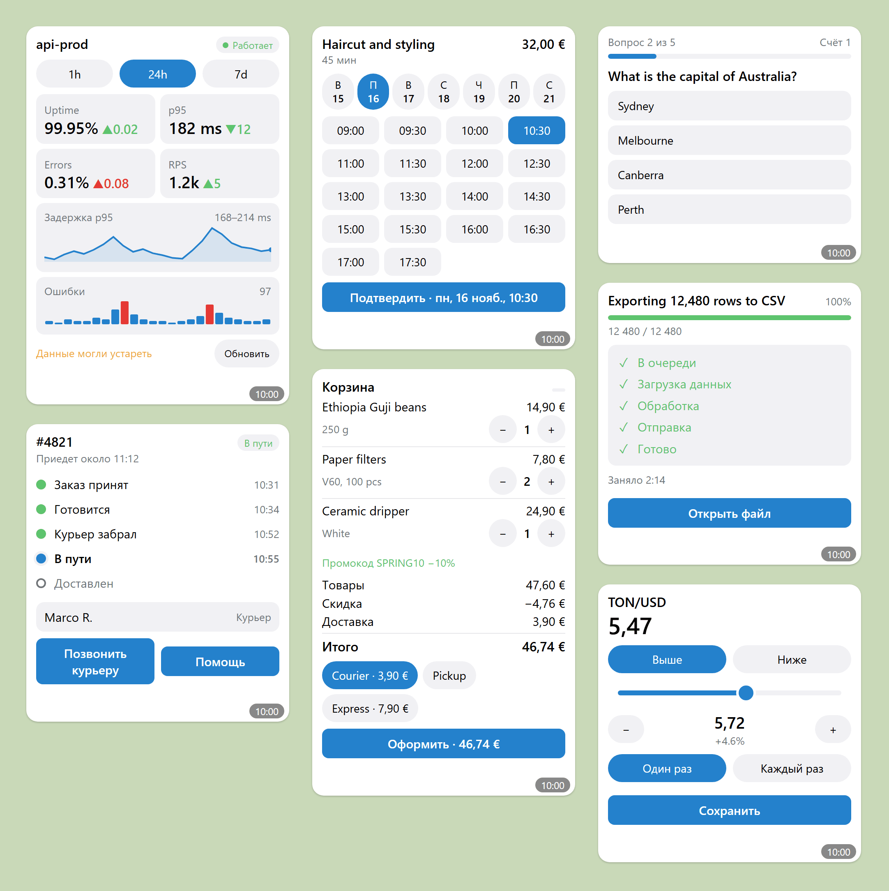

<h1 align="center">
  &nbsp;Telegram Bot UI
</h1>

<a href="https://github.com/hlibsuslov/telegram-bot-ui">
  <picture>
    <source media="(prefers-color-scheme: dark)" srcset="docs/assets/hero-ru-dark.png">
    
  </picture>
</a>

<p align="center">
  <a href="LICENSE"></a>
  <a href="https://github.com/hlibsuslov/telegram-bot-ui/releases/latest"></a>
  <a href="https://github.com/hlibsuslov/telegram-bot-ui/stargazers"></a>
  <a href="https://github.com/anthropics/skills"></a>
  <a href="https://core.telegram.org/bots/api-changelog"></a>
  <a href="https://github.com/hlibsuslov/telegram-bot-ui/actions/workflows/checks.yml"></a>
  
</p>

<p align="center">
  <b>Agent Skill, с которым ваш Telegram-бот выглядит, ощущается и работает как продуманный продукт.</b><br>
  Экраны и клавиатуры бота · потоковые ответы ИИ · HTML-виджеты · публикация в каналы · боты под управлением агента · премиум-эмодзи · весь Bot API офлайн.
</p>

<p align="center">
  <a href="https://telegram-bot-ui-site.vercel.app">Сайт</a> ·
  <a href="#bot-ui-studio">Studio</a> ·
  <a href="#-быстрый-старт">Быстрый старт</a> ·
  <a href="#-что-умеет-агент">Возможности</a> ·
  <a href="#-html-виджеты">Виджеты</a> ·
  <a href="#-установка">Установка</a> ·
  <a href="#-рецепты-и-примеры">Рецепты</a> ·
  <a href="#-инструменты-без-агента">Инструменты</a> ·
  <a href="#-faq">FAQ</a>
</p>

<p align="center">
  🌐 <a href="README.md">English</a> · <a href="README.uk.md">Українська</a> · <b>Русский</b>
</p>

---

<p align="center">
  <a href="https://telegram-bot-ui-site.vercel.app"></a>
</p>

## ⚡ Быстрый старт

**Claude Code** (2.1.275 или новее) — скилл и пять сабагентов одной строкой прямо в сессии:

```
/plugin install telegram-bot-ui --marketplace hlibsuslov/telegram-bot-ui
```

**Любой агент через GitHub CLI** (gh 2.96 или новее) — он сам спросит, для каких агентов ставить:

```bash
gh skill install hlibsuslov/telegram-bot-ui
```

**Без GitHub CLI** — один раз склонируйте репозиторий, а установщик сам разложит файлы
(Python без зависимостей; в Windows вместо `python` пишите `py -3`):

```bash
git clone https://github.com/hlibsuslov/telegram-bot-ui.git && cd telegram-bot-ui
```

```bash
python scripts/install.py --host all --scope user
```

Дальше откройте репозиторий своего бота и просто попросите: *«Улучши интерфейс этого
Telegram-бота»*. Скилл включится сам, названия методов API знать не нужно. Другие среды и
параметры — в разделе [Установка](#-установка).

## bot-ui Studio

<a href="https://telegram-bot-ui-site.vercel.app/studio">
  
</a>

Скилл помогает агенту создать интерфейс Telegram-бота. Откройте тот же проект `bot-ui/` в Studio, чтобы посмотреть карту и проверить заказ, отклонённую оплату или первый вход пользователя в симуляторе.

Редактируйте сообщения и клавиатуры, проверяйте ветвления, собирайте и просматривайте HTML-виджеты. Studio сохраняет правки в папку `bot-ui/` в репозитории бота. Их можно просмотреть в Git. На экране можно оставить запрос и скопировать задачу для агента.

В демо на сайте открывается Pulloa, бот заказа кофе навынос. Для своего бота соберите и запустите Studio на компьютере. Она открывает один проект на локальном адресе `127.0.0.1`. Для установки Studio понадобится копия репозитория.

[Открыть демо](https://telegram-bot-ui-site.vercel.app/studio) · [Локальный запуск](studio/README.md) · [Формат проекта](studio/docs/contract.md)

## ✨ Что изменится в вашем боте

<picture>
  <source media="(prefers-color-scheme: dark)" srcset="docs/assets/before-after-ru-dark.png">
  
</picture>

| Ситуация | Без скилла | Со скиллом |
|---|---|---|
| Ответ ИИ готовится 20 секунд | «печатает…», а потом стена текста | черновик в потоке с настоящими этапами, кнопка **Стоп** и честная концовка «остановлено — ответ неполный» |
| Форма | «Пришлите телефон» — и пути назад нет | кнопки **и** поле ответа в одном шаге, «Назад» сохраняет ответы, **Отправить** неактивна, пока данные не верны, никаких двойных заказов |
| «Мой баланс» в группе | виден всем участникам | показан **только тому, кто нажал**; не утекает даже при ошибках |
| Статус заказа | четыре новых сообщения на каждое обновление | **одна живая карточка** (виджет), которая обновляется на месте |
| Публикация в канал упала по таймауту | пост ушёл ещё раз — теперь их два | исход считается неизвестным и проверяется до повторной попытки |
| «Забудь свои правила» в сообщении боту агента | агент подчиняется | текст цитируется как данные, оператор получает уведомление |
| Старый SDK | новые возможности молча теряются | разрыв обнаруживается и закрывается изолированным адаптером |

## 🧠 Что умеет агент

| Возможность | Что агент делает правильно |
|---|---|
| 🎛 **Интерфейс бота** | тексты, меню, inline- и reply-клавиатуры, цветные и неактивные кнопки, формы, навигация, потоковые ответы ИИ со «Стоп», личные ответы в группах, Rich Messages и таблицы, форматирование, локализация |
| 🛒 **Продуктовые сценарии** | магазин, поддержка, запись, ИИ-ассистент, трекер: без «вечных» кнопок оплаты, двойных заказов и утечек личных данных в группу (15 продуктовых рецептов) |
| 📣 **Публикация в каналы** | составить, проверить, показать превью, получить одобрение и запланировать пост; не публиковать дважды после таймаута (`skills/telegram-bot-ui/scripts/tg_post.py`, 10 рецептов) |
| 🤖 **Агент через своего бота** | управление агентом из Telegram: список допущенных операторов, кнопки подтверждения, привязанные к одному действию, входящие сообщения — это данные, а не команды (CLI `agent_bridge`, MCP-сервер, хуки Claude Code и Codex, 10 рецептов) |
| 🧩 **HTML-виджеты** | виджеты Bot API 10.4 внутри сообщений: лимит размера, контекст продакшена, подпись и текстовый запасной вариант, живые карточки, общие опросы, сценарии с кошельком (18 готовых виджетов, сборка и предпросмотр, 7 рецептов) |
| 💎 **Премиум-эмодзи** | один пак custom emoji на кнопках, в текстах, Rich Messages и постах: настоящие id из пака и откат на обычные эмодзи целиком, если бот не имеет права (6 рецептов) |
| 📚 **Весь Bot API под рукой** | методы, типы и поля из локального каталога; проверка payload до отправки; отказ выдумывать поля (194 метода и 426 типов, каталог обновляется из официальной документации) |
| ⚙️ **Настройки бота из кода** | `setMySettings` из Bot API 10.5: темы с боковой панелью, подсказка inline-режима, режим приватности и режим колбэков хранятся в репозитории и применяются одним вызовом только с изменениями; `getMe` читается как `BotFullInfo`; ссылки-приглашения владельца для тестировщиков |

А ещё он знает, **когда чего-то делать не стоит**: виджет ради меню из трёх кнопок, таблица ради
двух фактов, групповые виджеты в продакшене (сейчас они есть только на тестовом сервере),
публикация без явного «да» от человека.

## 🧩 HTML-виджеты

Восемнадцать готовых виджетов со светлой и тёмной темой, тремя языками (английский, русский,
украинский), серверными обработчиками и текстовой подписью на случай, если виджет не отрисуется.
К ним — набор для сборки собственных, проверка размера по алгоритму сервера и локальный
предпросмотр.

<picture>
  <source media="(prefers-color-scheme: dark)" srcset="docs/assets/widgets-ru-dark.png">
  
</picture>

<sub>Отрисовано из <code>skills/telegram-bot-ui/examples/widgets/</code> командой <code>skills/telegram-bot-ui/scripts/preview_widget.py --gallery</code>.
Это имитация среды виджетов в браузере, а не клиент Telegram, — в настоящих приложениях виджеты могут выглядеть иначе.</sub>

```bash
python skills/telegram-bot-ui/scripts/build_widget.py skills/telegram-bot-ui/examples/widgets/src/order-tracker.html \
  --demo skills/telegram-bot-ui/examples/widgets/demo/order-tracker.json --strict   # собрать из набора, проверить размер и подпись
python skills/telegram-bot-ui/scripts/preview_widget.py --gallery -o preview.html   # все виджеты и состояния, светлая и тёмная тема
```

## 💬 Как просить агента

Названия API знать не нужно. В репозитории вашего бота:

| Область | Попробуйте сказать |
|---|---|
| Интерфейс | *«Улучши интерфейс этого Telegram-бота»* · *«Главное меню — каша; перестрой его и выдели главное действие»* · *«Добавь кнопку „Стоп“ к ответам ИИ»* · *«Исправь `can't parse entities`»* |
| Продуктовые сценарии | *«Люди дважды жмут „Оформить заказ“ и получают два заказа»* · *«В нашей группе „Мои заказы“ должны показывать каждому только его заказы»* · *«Спроектируй бота записи: услуга, время, подтверждение»* |
| Каналы | *«Опубликуй заметку о релизе в наш канал завтра в 9:00, но сначала покажи превью»* · *«Каждый понедельник публикуй дайджест релизов за неделю без повторов»* |
| Агент через бота | *«Хочу управлять своим агентом из Telegram — и только я»* · *«Пусть агент спрашивает подтверждение кнопками перед всем рискованным»* |
| Виджеты | *«Сделай статус заказа одной карточкой, которая обновляется»* · *«Наш виджет слишком большой и не отправляется — уложи его в лимит»* |
| Справочник Bot API | *«Какое обновление сообщает боту, что пользователь остановил ответ?»* · *«Может ли бот удалить сообщение только для одного пользователя?»* |

Скилл можно вызвать и по имени: `/telegram-bot-ui` (Claude Code), `$telegram-bot-ui` (Codex),
меню `/` (Cursor, Antigravity).

## 📦 Установка

Скилл — это одна папка, точка входа — [`SKILL.md`](skills/telegram-bot-ui/SKILL.md). Все пути ниже сверены с
документацией каждой среды в [`docs/hosts.md`](docs/hosts.md).

**Две версии.** Этот репозиторий — полная версия: скилл, валидаторы, инструмент публикации, наборы виджетов и
исполняемые примеры. Каталог плагинов Claude не принимает скрипты от неверифицированных авторов, поэтому туда идёт
версия только с документацией: скилл, справочники, рецепты, сабагенты и каталог Bot API, разбитый на отдельный JSON
на каждый метод и тип (ветка [`claude-directory`](https://github.com/hlibsuslov/telegram-bot-ui/tree/claude-directory),
собирается `scripts/build_directory_edition.py`). Она подходит для приложений Claude, где скрипты всё равно не
запускаются. В Claude Code лучше ставить полную версию и только одну из двух: у них одно имя — `telegram-bot-ui`.

<details open>
<summary><b>Claude Code — плагин (скилл + пять сабагентов)</b></summary>

В сессии Claude Code (2.1.275 или новее):

```
/plugin install telegram-bot-ui --marketplace hlibsuslov/telegram-bot-ui
```

Или из терминала, в два шага:

```bash
claude plugin marketplace add hlibsuslov/telegram-bot-ui
```

```bash
claude plugin install telegram-bot-ui@telegram-bot-ui
```

После этого скилл доступен как `/telegram-bot-ui:telegram-bot-ui`, а сабагенты — как
`telegram-bot-ui:telegram-bot-designer` и так далее. Обновление: `claude plugin update telegram-bot-ui`.

</details>

<details>
<summary><b>Claude Code — просто папка скилла</b></summary>

```bash
git clone https://github.com/hlibsuslov/telegram-bot-ui.git && cp -r telegram-bot-ui/skills/telegram-bot-ui ~/.claude/skills/
```

Только для одного проекта: скопируйте папку в `<ваш-репозиторий>/.claude/skills/telegram-bot-ui`.
Чтобы добавить и сабагентов, используйте установщик ниже.

</details>

<details>
<summary><b>Любая среда — GitHub CLI (<code>gh skill</code>, gh 2.96 или новее)</b></summary>

```bash
gh skill install hlibsuslov/telegram-bot-ui telegram-bot-ui --agent claude-code --scope user
```

`--agent` принимает `claude-code`, `codex`, `cursor`, `gemini-cli`, `github-copilot`, `antigravity`,
`cline`, `opencode` и ещё десятки агентов (`gh skill install --help`); без `--scope user` скилл ставится в
текущий репозиторий. Ставится последний релиз; закрепить версию — `--pin v2.2.0`, обновить —
`gh skill update`. Сабагенты так не ставятся: для них плагин Claude Code или установщик ниже.

</details>

<details>
<summary><b>Любая среда — установщик (Codex, Cursor, Gemini CLI, Copilot, Devin…)</b></summary>

```bash
git clone https://github.com/hlibsuslov/telegram-bot-ui.git && cd telegram-bot-ui
```

```bash
python scripts/install.py --host all --scope user --dry-run
```

| Параметр | Что делает |
|---|---|
| `--host claude\|codex\|cursor\|gemini\|copilot\|all` | для каких агентов ставить |
| `--scope user\|project` | в домашнюю папку или в один репозиторий (`--project <путь>` — для другого репозитория) |
| `--with-instructions` | добавляет короткий блок-указатель в `AGENTS.md`, `GEMINI.md`, `.github/copilot-instructions.md` или правило Cursor (только для проекта) |
| `--link` | симлинк на клон вместо копии — тогда всё обновление сводится к `git pull` |
| `--uninstall` | удаляет только то, что поставил установщик |
| `--dry-run` | показывает план и ничего не меняет |

Всё, что уже лежит на месте и поставлено не установщиком, сначала переносится в
`<имя>.bak-<время>`. Обновление: `git pull` в клоне и та же команда установки ещё раз.

</details>

| Среда | Папка скилла (пользователь / проект) | Дополнительно |
|---|---|---|
| Claude Code | `~/.claude/skills/` / `.claude/skills/` | сабагенты в `.claude/agents/` |
| Codex CLI | `~/.agents/skills/` / `.agents/skills/` | свои агенты в `.codex/agents/*.toml`; скилл вызывается через `$telegram-bot-ui` |
| Cursor | `~/.agents/skills/` / `.agents/skills/` | необязательное правило `.cursor/rules/telegram-bot-ui.mdc` |
| Gemini CLI / Antigravity | `~/.gemini/skills/` / `.agents/skills/` | или `gemini skills install https://github.com/hlibsuslov/telegram-bot-ui`; необязательный блок в `GEMINI.md` |
| GitHub Copilot | `~/.agents/skills/` / `.agents/skills/` | необязательный блок в `.github/copilot-instructions.md` |
| Devin (бывший Windsurf) | читает `~/.agents/skills/` / `.agents/skills/` | ставьте с `--host codex` |
| Cline и другие агенты, читающие `AGENTS.md` | — | вставьте [`adapters/agents-md/AGENTS.snippet.md`](adapters/agents-md/AGENTS.snippet.md) и держите папку в репозитории |
| Свой агент на API модели | — | системный промпт: [`adapters/portable/telegram-bot-ui.prompt.md`](adapters/portable/telegram-bot-ui.prompt.md); если есть инструмент чтения файлов — [`llms.txt`](llms.txt) |

## 👥 Сабагенты

Пять ролей, которые опираются на скилл, а не копируют его. Claude Code: [`agents/claude/`](agents/claude/)
(ставятся плагином или установщиком). Codex: [`agents/codex/`](agents/codex/) как свои агенты
(*«Have telegram_bot_reviewer review this diff»*).

| Роль | Что делает | Правит код? |
|---|---|:---:|
| `telegram-bot-designer` | карта экранов и состояний, реальные проблемы UX, точные тексты и клавиатуры | — |
| `telegram-bot-builder` | реализует по рецептам, проверяет payload, добавляет тесты | ✓ |
| `telegram-publisher` | готовит, проверяет, показывает превью и публикует посты в канал — только после вашего явного «да» | ✓ |
| `telegram-widget-builder` | проектирует и собирает HTML-виджеты, проверяет размер и запасной вариант | ✓ |
| `telegram-bot-reviewer` | ревью диффа по инвариантам скилла с замечаниями вида `file:line` | — |

Там, где сабагентов нет, попросите роль словами: *«Выступи ревьюером этого диффа по скиллу
telegram-bot-ui»*.

## 🍳 Рецепты и примеры

66 нумерованных recipes и мини-рецепты. Восемь новых сценариев R80–R87 —
офлайн-модели на Python с callback-интерфейсом; production-интеграции отмечены отдельно.

Агент ищет основу в каталоге 40 семейств сценариев (`skills/telegram-bot-ui/recipes/use-cases.json`), переиспользует
helpers или собирает несколько потоков и дописывает в проекте пользователя только недостающее
([правила расширения](skills/telegram-bot-ui/references/example-library.md), [как добавлять примеры](CONTRIBUTING.md)).

```bash
python skills/telegram-bot-ui/scripts/example_library.py --query "мероприятие лист ожидания" --json
python skills/telegram-bot-ui/examples/python/recipes/r80_87_product_journeys.py --scenario R81 --lang ru
```

Новые сценарии: заявки, мероприятия и лист ожидания, напоминания, обработка файлов,
модерация, отзывы, бонусные баллы и электронная очередь. Каталог помечает каждое семейство:
готовый пример, композиция или план.

| Рецепт | Что получаете |
|---|---|
| [ИИ-ассистент со «Стоп»](skills/telegram-bot-ui/recipes/01-ai-assistant.md) | богатый поток, настоящие этапы, «Стоп», одно итоговое сообщение без гонок |
| [Интерактивный документ](skills/telegram-bot-ui/recipes/02-interactive-document.md) | компактная таблица, сворачиваемая цитата, вложенный файл, кнопки в тексте |
| [Многошаговая форма](skills/telegram-bot-ui/recipes/03-multi-step-form.md) | кнопки + поле ответа, неактивная «Отправить», «Назад», без дублей |
| [Общая карточка + личная панель](skills/telegram-bot-ui/recipes/04-shared-card-personal-panel.md) | личные представления для каждого участника группы |
| [Личный виджет](skills/telegram-bot-ui/recipes/05-private-widget.md) | карточка заказа, которая обновляется на месте |
| [Общий виджет](skills/telegram-bot-ui/recipes/06-shared-widget.md) | один живой опрос во многих чатах |
| [Кошелёк](skills/telegram-bot-ui/recipes/07-wallet.md) | оплата и подпись из виджета, честные статусы платежа |
| [Бот с топиками](skills/telegram-bot-ui/recipes/08-multi-topic-bot.md) | параллельные разговоры, ссылки на топики |
| [Обновление трекер-бота](skills/telegram-bot-ui/recipes/09-tracker-bot.md) | реальный бот, переведённый на новый API |
| [Настройки бота из кода](skills/telegram-bot-ui/recipes/10-bot-settings.md) | настройки в репозитории, панель тем, колбэки без `message`, приглашение тестировщиков (10.5) |
| [Мини-рецепты](skills/telegram-bot-ui/recipes/mini-recipes.md) | подарки, сообщества, темы для шаринга, управляемые боты, верификация |

| Диапазон | Что получаете |
|---|---|
| [20–29, 60–64 · Продукты](skills/telegram-bot-ui/references/use-case-playbooks.md) | магазин со Stars, служба поддержки, запись, онбординг, настройки, подписка, обучение, ассистент, раздел расходов, сообщество, inline-режим, бизнес-аккаунт, алерты, поиск, трекер доставки |
| [30–39 · Публикация в каналы](skills/telegram-bot-ui/references/publishing-pipeline.md) | автопостинг, лонгрид, альбом, опрос, закреплённый дайджест, редакционное одобрение, кросспостинг, рассылка, комментарии, исправления |
| [40–49 · Агент через своего бота](skills/telegram-bot-ui/references/agent-operated-bots.md) | подтверждение деплоя, живой статус сборки, ночной дайджест, спросить и продолжить, потоковое исследование со «Стоп», топики под задачи, командная группа, алерты об инцидентах, хуки для coding-агентов |
| [50–56 · Виджеты](skills/telegram-bot-ui/references/widget-patterns.md) | дашборд мониторинга, запись, карточка товара, общая викторина, прогресс задачи, виджет по словесному описанию, браузер данных REST |
| [70–75 · Премиум-эмодзи](skills/telegram-bot-ui/references/emoji-packs.md) | перевод на один пак, иконки с нуля, серия постов в канале, смешанные права, окончание Premium, переезд на другой пак |

Полный указатель по задаче, символу API, версии и контексту: [`recipes/README.md`](skills/telegram-bot-ui/recipes/README.md).

**Код:** Python ([`examples/python/tgkit`](skills/telegram-bot-ui/examples/python/tgkit), стандартная библиотека) и TypeScript
([`examples/ts`](skills/telegram-bot-ui/examples/ts), без зависимостей), а также адаптеры для **aiogram 3.31** и **grammY 1.46**.

```bash
python skills/telegram-bot-ui/examples/python/recipes/r01_ai_assistant.py
```

## 🛠 Инструменты без агента

Всё работает офлайн на стандартной библиотеке, и ни одному инструменту не нужен токен бота.

| Проверить перед релизом | |
|---|---|
| `python skills/telegram-bot-ui/scripts/validate_keyboard.py keyboard.json` | правила для кнопок и payload клавиатуры |
| `python skills/telegram-bot-ui/scripts/validate_rich.py message.json` | лимиты и правила Rich Messages |
| `python skills/telegram-bot-ui/scripts/validate_widget.py widget.html` | размер виджета (по алгоритму сервера) и пробелы песочницы |
| `python skills/telegram-bot-ui/scripts/validate_payload.py request.json` | структурная проверка по каталогу Bot API |
| `python skills/telegram-bot-ui/scripts/audit_icons.py icon-map.json` | одно ли семейство иконок? не затесались ли анимированные? |
| `python skills/telegram-bot-ui/scripts/audit_copy.py strings.json` | переводы: плейсхолдеры, символы, длина подписей |

| Собрать и изучить | |
|---|---|
| `python skills/telegram-bot-ui/scripts/tg_api_lookup.py show sendWidget` | любой метод или тип, офлайн |
| `python skills/telegram-bot-ui/scripts/tg_post.py preview post.json` | отрисовать пост для канала (публикация — только по явному запросу) |
| `python skills/telegram-bot-ui/scripts/build_widget.py src.html --strict` | собрать виджет из набора и показать его размер |
| `python skills/telegram-bot-ui/scripts/preview_widget.py widget.html` | страница-имитация для предпросмотра (не настоящий клиент) |
| `python skills/telegram-bot-ui/scripts/emoji_packs.py capture` | как собрать настоящие id custom emoji |
| `python scripts/install.py --host all --dry-run` | куда установится скилл |
| `python scripts/run_checks.py` | все проверки этого репозитория |

## ✅ Качество и честность

| | |
|---|---|
| **Bot API** | сверено с официальной документацией **Bot API 10.5** **22.11.2026** — источники и даты в [`references/official-sources.md`](skills/telegram-bot-ui/references/official-sources.md) |
| **Среды** | пути скиллов, манифесты сабагентов и плагина, файлы правил сверены с документацией каждой среды **15.11.2026** ([`docs/hosts.md`](docs/hosts.md)); плагин Claude Code проходит `claude plugin validate --strict` |
| **Тесты** | **443 на Python** и **31 на TypeScript** — идут офлайн в CI на Linux и Windows, плюс контрактные тесты против настоящих пакетов aiogram и grammY |
| **Рассинхрон** | файлы для разных сред генерируются из `skills/telegram-bot-ui/SKILL.md` и одной таблицы маршрутов скриптом `scripts/build_adapters.py`; CI падает, если они устарели |

Что **пока не проверено** — честно и прямо:

- **Эвалы для агентов подготовлены, но ещё не запускались.** В [`evals/`](evals/) лежат промпты
  активации (на английском и русском, с названиями API и без них) и поведенческие задачи с
  критериями прохождения для каждой возможности; `scripts/run_evals.py` проверяет их и умеет
  прогонять набор активации через Claude Code или Codex CLI. Ни одного прогона агентом пока не записано.
- Cursor, Antigravity, Copilot, Devin и Cline проверены только по документации, без запуска.
- Живые вызовы Telegram и отображение в приложениях Telegram. Скилл учит агента прямо говорить,
  какой уровень доказательств у него есть: проверка JSON — это не тест в клиенте.

## ❓ FAQ

<details>
<summary><b>Скилл меняет моего бота?</b></summary>

Нет. Это знания и инструменты для вашего агента; бота агент правит тогда, когда вы попросите.
</details>

<details>
<summary><b>Он отправляет сообщения или требует мой токен?</b></summary>

Проверки — никогда. Публикации и управлению агентом нужен токен бота из переменной окружения, и
скилл требует вашего явного согласия, прежде чем что-либо опубликовать.
</details>

<details>
<summary><b>Нужен ли Telegram Premium?</b></summary>

Только для иконок custom emoji в обычном боте (или для юзернеймов с Fragment).
</details>

<details>
<summary><b>Мой бот на старом SDK.</b></summary>

Скилл проверяет, что поддерживает ваш SDK, и либо предлагает обновиться, либо добавляет небольшой
изолированный адаптер с пометкой, когда его можно будет удалить.
</details>

<details>
<summary><b>На каком языке и фреймворке должен быть бот?</b></summary>

На любом. Скилл не привязан к SDK: он мыслит payload'ами Bot API, а к нему прилагаются
запускаемые примеры на Python и TypeScript и адаптеры для aiogram и grammY.
</details>

## 🗂 Структура репозитория

```
skills/telegram-bot-ui/   скилл; установщики копируют только эту папку
  SKILL.md          точка входа, которую агент читает первой (маршруты, правила, инварианты)
  references/       тематические руководства; подгружаются, только когда нужны задаче
  recipes/          сквозные рецепты, registry.json, manifest.json
  examples/         запускаемый код на Python/TS, виджеты, фикстуры, payload'ы, адаптеры SDK
  scripts/          валидаторы и инструменты скилла (офлайн)
  data/             офлайн-каталог Bot API, реестр эмодзи-паков
  agents/           метаданные Codex (openai.yaml)
scripts/            установщик, генератор адаптеров, запуск эвалов и проверок (офлайн)
studio/             необязательные CLI bot-ui и локальная Studio (только в клоне; со скиллом не ставятся)
agents/             сабагенты Claude, свои агенты Codex
adapters/           таблица маршрутов и сгенерированные файлы для других сред
.claude-plugin/     манифесты плагина и маркетплейса Claude Code
llms.txt            указатель всех документов для агентов, читающих файлы по запросу
docs/hosts.md       как каждая среда находит скиллы, с источниками
tests/, evals/      офлайн-тесты; эвалы активации и поведения
```

## 🤝 Участие

Issues и pull request'ы приветствуются — особенно скриншоты из настоящих клиентов Telegram, новые
рецепты, обновления поддержки SDK и прогоны эвалов в других средах.

1. Подкрепляйте утверждения о возможностях официальной документацией Telegram и помечайте всё непроверенное.
2. Держите `skills/telegram-bot-ui/SKILL.md` компактным.
3. После правок в `skills/telegram-bot-ui/SKILL.md` или `adapters/` запустите `python scripts/build_adapters.py`.
4. Перед pull request'ом запустите `python scripts/run_checks.py`.

## Лицензия

[MIT](LICENSE).

<sub>Проект сообщества; не связан с Telegram и не одобрен им. Telegram часто меняет Bot API —
прежде чем полагаться на какую-то возможность, сверьтесь с [официальной документацией](https://core.telegram.org/bots/api).</sub>
