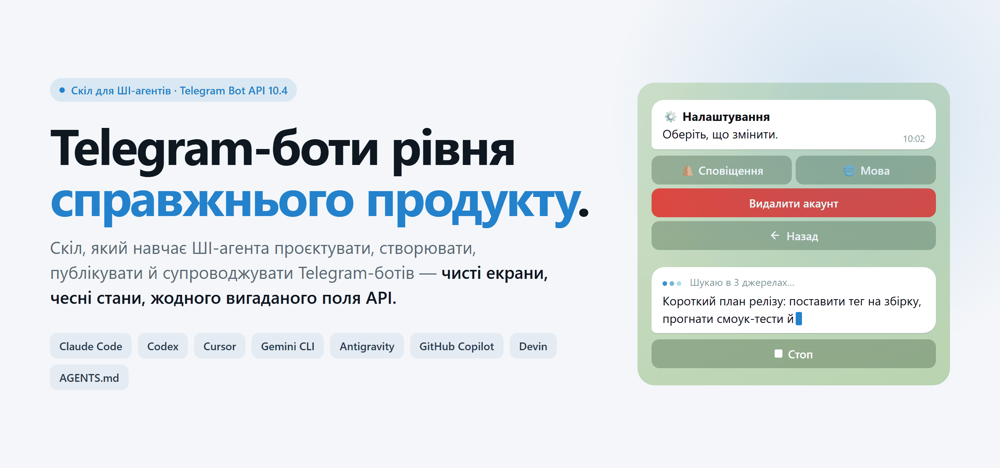
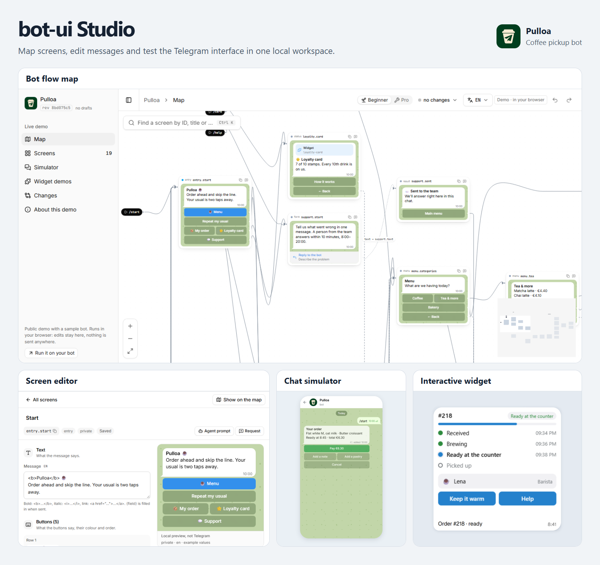
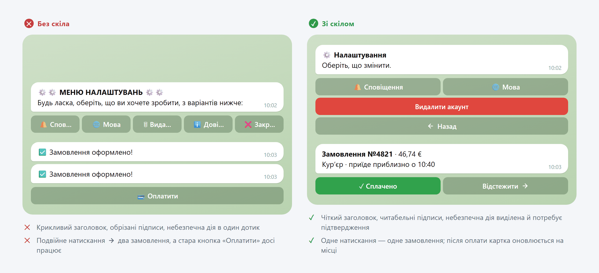
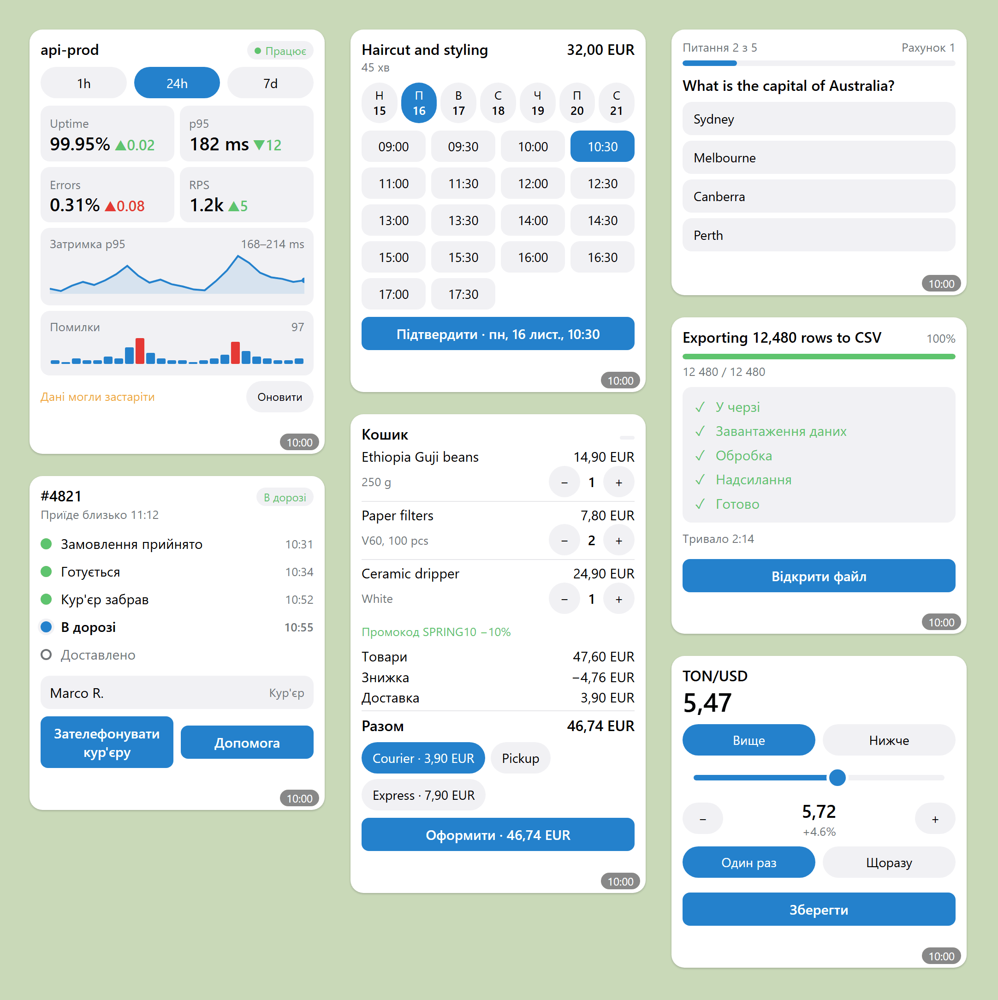

<h1 align="center">
  &nbsp;Telegram Bot UI
</h1>

<a href="https://github.com/hlibsuslov/telegram-bot-ui">
  <picture>
    <source media="(prefers-color-scheme: dark)" srcset="docs/assets/hero-uk-dark.png">
    
  </picture>
</a>

<p align="center">
  <a href="LICENSE"></a>
  <a href="https://github.com/hlibsuslov/telegram-bot-ui/releases/latest"></a>
  <a href="https://github.com/hlibsuslov/telegram-bot-ui/stargazers"></a>
  <a href="https://github.com/anthropics/skills"></a>
  <a href="https://core.telegram.org/bots/api-changelog"></a>
  <a href="https://github.com/hlibsuslov/telegram-bot-ui/actions/workflows/checks.yml"></a>
  
</p>

<p align="center">
  <b>Agent Skill, з яким ваш Telegram-бот виглядає, відчувається й працює як добре продуманий продукт.</b><br>
  Екрани й клавіатури бота · потокові відповіді ШІ · HTML-віджети · публікації в каналах · боти, якими керує агент · преміум-емодзі · увесь Bot API офлайн.
</p>

<p align="center">
  <a href="https://telegram-bot-ui-site.vercel.app">Сайт</a> ·
  <a href="#bot-ui-studio">Studio</a> ·
  <a href="#-швидкий-старт">Швидкий старт</a> ·
  <a href="#-що-вміє-ваш-агент">Можливості</a> ·
  <a href="#-html-віджети">Віджети</a> ·
  <a href="#-встановлення">Встановлення</a> ·
  <a href="#-рецепти-й-приклади">Рецепти</a> ·
  <a href="#-інструменти-без-агента">Інструменти</a> ·
  <a href="#-часті-запитання">Запитання</a>
</p>

<p align="center">
  🌐 <a href="README.md">English</a> · <b>Українська</b> · <a href="README.ru.md">Русский</a>
</p>

---

<p align="center">
  <a href="https://telegram-bot-ui-site.vercel.app"></a>
</p>

## ⚡ Швидкий старт

**Claude Code** (2.1.275 або новіший) — скіл і пʼять субагентів, одним рядком просто в сесії:

```
/plugin install telegram-bot-ui --marketplace hlibsuslov/telegram-bot-ui
```

**Будь-який агент через GitHub CLI** (gh 2.96 або новіший) — він сам запитає, для яких агентів ставити:

```bash
gh skill install hlibsuslov/telegram-bot-ui
```

**Без GitHub CLI** — один раз клонуйте репозиторій, а інсталятор розкладе файли куди
треба (потрібен лише Python зі стандартною бібліотекою; у Windows замість `python` пишіть `py -3`):

```bash
git clone https://github.com/hlibsuslov/telegram-bot-ui.git && cd telegram-bot-ui
```

```bash
python scripts/install.py --host all --scope user
```

Далі відкрийте репозиторій свого бота й просто попросіть: *«Покращ UX цього Telegram-бота».*
Скіл увімкнеться сам — назви методів API знати не потрібно. Інші середовища й параметри — у
розділі [Встановлення](#-встановлення).

## bot-ui Studio

<a href="https://telegram-bot-ui-site.vercel.app/studio">
  
</a>

Скіл допомагає агенту створити інтерфейс Telegram-бота. Відкрийте той самий проєкт `bot-ui/` у Studio, щоб переглянути карту й перевірити замовлення, відхилену оплату або перший вхід користувача в симуляторі.

Редагуйте повідомлення й клавіатури, перевіряйте розгалуження, збирайте та переглядайте HTML-віджети. Studio зберігає зміни в папку `bot-ui/` у репозиторії бота. Їх можна переглянути в Git. На екрані можна залишити запит і скопіювати завдання для агента.

У демо на сайті відкривається Pulloa, бот замовлення кави з собою. Для свого бота зберіть і запустіть Studio на комп’ютері. Вона відкриває один проєкт на локальній адресі `127.0.0.1`. Для встановлення Studio потрібна копія репозиторію.

[Відкрити демо](https://telegram-bot-ui-site.vercel.app/studio) · [Локальний запуск](studio/README.md) · [Формат проєкту](studio/docs/contract.md)

## ✨ Що зміниться у вашому боті

<picture>
  <source media="(prefers-color-scheme: dark)" srcset="docs/assets/before-after-uk-dark.png">
  
</picture>

| Ситуація | Без скіла | Зі скілом |
|---|---|---|
| Відповідь ШІ готується 20 с | «друкує…», а потім суцільна стіна тексту | потокова чернетка зі справжніми етапами, кнопка **Stop** і зрозуміле завершення «зупинено — відповідь неповна» |
| Форма | «Надішліть свій телефон» — і жодного шляху назад | кнопки **й** поле для відповіді на одному кроці, «Назад» зберігає відповіді, **Надіслати** неактивна, доки дані не коректні, жодних подвійних замовлень |
| «Мій баланс» у групі | бачать усі учасники | показується **лише тому, хто натиснув**; не витікає навіть у разі помилки |
| Статус замовлення | чотири нові повідомлення на кожне оновлення | **одна жива картка** (віджет), що оновлюється на місці |
| Публікація в каналі не дочекалася відповіді | пост відправлено ще раз — тепер їх два | результат вважається невідомим і перевіряється перед будь-якою повторною спробою |
| «Ігноруй свої правила» в повідомленні боту, яким керує агент | агент слухається | текст цитується як дані, оператора попереджають |
| Застарілий SDK | нові можливості мовчки губляться | розрив виявляється й закривається ізольованим адаптером |

## 🧠 Що вміє ваш агент

| Можливість | Що агент робить правильно |
|---|---|
| 🎛 **Інтерфейс бота** | тексти, меню, inline- і reply-клавіатури, кольорові й неактивні кнопки, форми, навігація, потокові відповіді ШІ з кнопкою Stop, особисті відповіді в групах, Rich Messages і таблиці, форматування, локалізація |
| 🛒 **Продуктові сценарії** | магазини, підтримка, запис на послуги, ШІ-асистенти, трекери: без застарілих кнопок «Оплатити», подвійних замовлень і витоку особистих даних у групи (15 продуктових рецептів) |
| 📣 **Публікації в каналах** | скласти, перевірити, показати превʼю, погодити й запланувати пост; ніколи не публікувати двічі після тайм-ауту (`skills/telegram-bot-ui/scripts/tg_post.py`, 10 рецептів) |
| 🤖 **Агент, що працює через бота** | керування агентом із Telegram: список дозволених операторів, кнопки підтвердження, привʼязані до однієї конкретної дії, вхідні повідомлення — це дані, а не інструкції (CLI `agent_bridge`, MCP-сервер, хуки Claude Code і Codex, 10 рецептів) |
| 🧩 **HTML-віджети** | віджети Bot API 10.4 усередині повідомлень: ліміт розміру, контекст продакшену, підпис і текстовий запасний варіант, живі картки, спільні опитування, сценарії з гаманцем (18 готових віджетів, інструменти збирання й перегляду, 7 рецептів) |
| 💎 **Преміум-емодзі** | один пак custom emoji на кнопках, у текстах, Rich Messages і постах: справжні id із паку, відкат на звичайні емодзі повністю, якщо бот не має права їх використовувати (6 рецептів) |
| 📚 **Довідник усього Bot API** | методи, типи й поля з локального каталогу; перевірка payload перед надсиланням; жодних вигаданих полів (194 методи, 426 типів, оновлюється з офіційної документації) |
| ⚙️ **Налаштування бота з коду** | `setMySettings` із Bot API 10.5: теми з бічною панеллю, підказка inline-режиму, режим приватності й режим колбеків зберігаються в репозиторії та застосовуються одним викликом лише зі змінами; `getMe` читається як `BotFullInfo`; посилання-запрошення власника для тестувальників |

А ще скіл знає, **коли чогось не варто робити**: жодного віджета заради меню з трьох кнопок,
жодної таблиці для двох фактів, жодних групових віджетів у продакшені (поки що вони працюють
лише на тестовому сервері), жодної публікації без «так» від людини.

## 🧩 HTML-віджети

Вісімнадцять готових віджетів зі світлою й темною темами, трьома мовами, серверними обробниками
та запасним підписом — а ще набір для власних віджетів, перевірка розміру за алгоритмом сервера
й локальний перегляд.

<picture>
  <source media="(prefers-color-scheme: dark)" srcset="docs/assets/widgets-uk-dark.png">
  
</picture>

<sub>Знято з <code>skills/telegram-bot-ui/examples/widgets/</code> за допомогою <code>skills/telegram-bot-ui/scripts/preview_widget.py --gallery</code>.
Це імітація середовища віджетів у браузері на компʼютері, а не клієнт Telegram — справжні застосунки можуть малювати їх інакше.</sub>

```bash
python skills/telegram-bot-ui/scripts/build_widget.py skills/telegram-bot-ui/examples/widgets/src/order-tracker.html \
  --demo skills/telegram-bot-ui/examples/widgets/demo/order-tracker.json --strict   # зібрати з набору, перевірити розмір і підпис
python skills/telegram-bot-ui/scripts/preview_widget.py --gallery -o preview.html   # усі віджети й стани, світла й темна теми
```

## 💬 Попросіть агента

Назви API знати не потрібно. У репозиторії свого бота:

| Тема | Спробуйте сказати |
|---|---|
| Інтерфейс | *«Покращ UX цього Telegram-бота».* · *«Головне меню — суцільний хаос: перебудуй його й виділи головну дію».* · *«Додай кнопку Stop до відповідей ШІ».* · *«Виправ `can't parse entities`».* |
| Продуктові сценарії | *«Люди двічі тиснуть "Оформити замовлення" й отримують два замовлення».* · *«У нашій групі "Мої замовлення" має показувати кожному лише його власні замовлення».* · *«Спроєктуй бота для запису: послуга, час, підтвердження».* |
| Канали | *«Опублікуй цю нотатку про реліз у нашому каналі завтра о 9:00 — спершу покажи превʼю».* · *«Щопонеділка публікуй дайджест релізів за минулий тиждень без повторів».* |
| Агент через бота | *«Дай мені керувати моїм агентом для програмування з Telegram — і лише мені».* · *«Нехай агент просить підтвердження кнопками перед усім ризикованим».* |
| Віджети | *«Перетвори статус замовлення на одну картку, що оновлюється».* · *«Наш віджет завеликий для надсилання — зроби, щоб він вміщався».* |
| Довідник Bot API | *«Яке оновлення повідомляє бота, що користувач зупинив відповідь?»* · *«Чи може бот видалити повідомлення лише для одного користувача?»* |

Скіл можна викликати й за назвою: `/telegram-bot-ui` (Claude Code), `$telegram-bot-ui` (Codex),
меню `/` (Cursor, Antigravity).

## 📦 Встановлення

Скіл — це одна тека, точка входу якої — [`SKILL.md`](skills/telegram-bot-ui/SKILL.md). Кожен шлях нижче звірено з
документацією відповідного середовища в [`docs/hosts.md`](docs/hosts.md).

**Дві версії.** Цей репозиторій — повна версія: скіл, валідатори, інструмент публікації, набори віджетів і
виконувані приклади. Каталог плагінів Claude не приймає скрипти від неверифікованих авторів, тому туди йде
версія лише з документацією: скіл, довідники, рецепти, субагенти й каталог Bot API, розбитий на окремий JSON
для кожного методу й типу (гілка [`claude-directory`](https://github.com/hlibsuslov/telegram-bot-ui/tree/claude-directory),
збирається `scripts/build_directory_edition.py`). Вона підходить для застосунків Claude, де скрипти й так не
запускаються. У Claude Code краще ставити повну версію і лише одну з двох: у них однакове імʼя — `telegram-bot-ui`.

<details open>
<summary><b>Claude Code — плагін (скіл + пʼять субагентів)</b></summary>

У сесії Claude Code (2.1.275 або новіший):

```
/plugin install telegram-bot-ui --marketplace hlibsuslov/telegram-bot-ui
```

Або з термінала, у два кроки:

```bash
claude plugin marketplace add hlibsuslov/telegram-bot-ui
```

```bash
claude plugin install telegram-bot-ui@telegram-bot-ui
```

Після цього скіл доступний як `/telegram-bot-ui:telegram-bot-ui`, а субагенти — як
`telegram-bot-ui:telegram-bot-designer` тощо. Оновлення: `claude plugin update telegram-bot-ui`.

</details>

<details>
<summary><b>Claude Code — проста тека скіла</b></summary>

```bash
git clone https://github.com/hlibsuslov/telegram-bot-ui.git && cp -r telegram-bot-ui/skills/telegram-bot-ui ~/.claude/skills/
```

Лише для одного проєкту: скопіюйте теку в `<your-repo>/.claude/skills/telegram-bot-ui`. Щоб додати ще й
субагентів, скористайтеся інсталятором нижче.

</details>

<details>
<summary><b>Будь-яке середовище — GitHub CLI (<code>gh skill</code>, gh 2.96 або новіший)</b></summary>

```bash
gh skill install hlibsuslov/telegram-bot-ui telegram-bot-ui --agent claude-code --scope user
```

`--agent` приймає `claude-code`, `codex`, `cursor`, `gemini-cli`, `github-copilot`, `antigravity`,
`cline`, `opencode` і ще десятки агентів (`gh skill install --help`); без `--scope user` скіл ставиться в
поточний репозиторій. Ставиться останній реліз; закріпити версію — `--pin v2.2.0`, оновити —
`gh skill update`. Субагенти так не ставляться: для них плагін Claude Code або інсталятор нижче.

</details>

<details>
<summary><b>Будь-яке середовище — інсталятор (Codex, Cursor, Gemini CLI, Copilot, Devin…)</b></summary>

```bash
git clone https://github.com/hlibsuslov/telegram-bot-ui.git && cd telegram-bot-ui
```

```bash
python scripts/install.py --host all --scope user --dry-run
```

| Параметр | Що означає |
|---|---|
| `--host claude\|codex\|cursor\|gemini\|copilot\|all` | для яких агентів установлювати |
| `--scope user\|project` | у домашню теку або в один репозиторій (`--project <path>` — для іншого репозиторію) |
| `--with-instructions` | додає короткий блок-покажчик у `AGENTS.md`, `GEMINI.md`, `.github/copilot-instructions.md` або правило Cursor (лише для рівня проєкту) |
| `--link` | створює символьне посилання на клон замість копіювання, тож оновлення — це просто `git pull` |
| `--uninstall` | вилучає лише те, що створив інсталятор |
| `--dry-run` | показує план і нічого не змінює |

Усе, що вже лежить на місці й створено не інсталятором, спершу переміщується в `<name>.bak-<time>`.
Оновлення: `git pull` у клоні й повторний запуск тієї самої команди встановлення.

</details>

| Середовище | Тека скіла (користувач / проєкт) | Додатково |
|---|---|---|
| Claude Code | `~/.claude/skills/` / `.claude/skills/` | субагенти в `.claude/agents/` |
| Codex CLI | `~/.agents/skills/` / `.agents/skills/` | власні агенти в `.codex/agents/*.toml`; скіл викликається як `$telegram-bot-ui` |
| Cursor | `~/.agents/skills/` / `.agents/skills/` | необовʼязкове правило `.cursor/rules/telegram-bot-ui.mdc` |
| Gemini CLI / Antigravity | `~/.gemini/skills/` / `.agents/skills/` | або `gemini skills install https://github.com/hlibsuslov/telegram-bot-ui`; необовʼязковий блок у `GEMINI.md` |
| GitHub Copilot | `~/.agents/skills/` / `.agents/skills/` | необовʼязковий блок у `.github/copilot-instructions.md` |
| Devin (раніше Windsurf) | читає `~/.agents/skills/` / `.agents/skills/` | установлюйте з `--host codex` |
| Cline та інші, хто читає `AGENTS.md` | — | вставте [`adapters/agents-md/AGENTS.snippet.md`](adapters/agents-md/AGENTS.snippet.md) і тримайте теку в репозиторії |
| Ваш власний агент на API моделі | — | системний промпт: [`adapters/portable/telegram-bot-ui.prompt.md`](adapters/portable/telegram-bot-ui.prompt.md); з інструментом для читання файлів: [`llms.txt`](llms.txt) |

## 👥 Субагенти

Пʼять ролей, які спираються на скіл, а не копіюють його. Claude Code: [`agents/claude/`](agents/claude/)
(установлюються плагіном або інсталятором). Codex: [`agents/codex/`](agents/codex/) як власні
агенти (*«Have telegram_bot_reviewer review this diff»*).

| Роль | Що робить | Змінює код? |
|---|---|:---:|
| `telegram-bot-designer` | карта екранів і станів, справжні вади UX, точні тексти й клавіатури | — |
| `telegram-bot-builder` | реалізує за рецептами, перевіряє payload, додає тести | ✓ |
| `telegram-publisher` | складає, перевіряє, показує превʼю й публікує пости в каналі — лише після вашого явного «так» | ✓ |
| `telegram-widget-builder` | проєктує й збирає HTML-віджети, перевіряє розмір і запасний варіант | ✓ |
| `telegram-bot-reviewer` | перевіряє diff на відповідність інваріантам скіла, із зауваженнями у форматі `file:line` | — |

У середовищах без субагентів просто попросіть роль словами: *«Виступи рецензентом цього diff,
використовуючи скіл telegram-bot-ui».*

## 🍳 Рецепти й приклади

66 нумерованих recipes і міні-рецепти. Вісім нових сценаріїв R80–R87 —
офлайн-моделі Python із callback-інтерфейсом; production-інтеграції позначені окремо.

Агент шукає основу в каталозі 40 сімейств сценаріїв (`skills/telegram-bot-ui/recipes/use-cases.json`), повторно
використовує helpers або поєднує потоки й дописує в проєкті користувача лише відсутнє
([правила розширення](skills/telegram-bot-ui/references/example-library.md), [як додавати приклади](CONTRIBUTING.md)).

```bash
python skills/telegram-bot-ui/scripts/example_library.py --query "event waitlist" --json
python skills/telegram-bot-ui/examples/python/recipes/r80_87_product_journeys.py --scenario R81
```

Нові сценарії: заявки, події й список очікування, нагадування, обробка файлів,
модерація, відгуки, бонусні бали й електронна черга. Каталог позначає кожне сімейство:
готовий приклад, композиція або план.

| Рецепт | Що ви отримаєте |
|---|---|
| [ШІ-асистент із кнопкою Stop](skills/telegram-bot-ui/recipes/01-ai-assistant.md) | розширений потоковий вивід, справжні етапи, Stop, одне підсумкове повідомлення без гонок |
| [Інтерактивний документ](skills/telegram-bot-ui/recipes/02-interactive-document.md) | компактна таблиця, згортана цитата, вкладений файл, кнопки в тексті |
| [Багатокрокова форма](skills/telegram-bot-ui/recipes/03-multi-step-form.md) | кнопки + поле для відповіді, неактивна кнопка «Надіслати», «Назад», жодних дублікатів |
| [Спільна картка + особиста панель](skills/telegram-bot-ui/recipes/04-shared-card-personal-panel.md) | особисті подання для кожного учасника групи |
| [Приватний віджет](skills/telegram-bot-ui/recipes/05-private-widget.md) | картка замовлення, що оновлюється на місці |
| [Спільний віджет](skills/telegram-bot-ui/recipes/06-shared-widget.md) | одне живе опитування в багатьох чатах |
| [Гаманець](skills/telegram-bot-ui/recipes/07-wallet.md) | оплата й підпис із віджета, чесні стани платежу |
| [Бот із кількома темами](skills/telegram-bot-ui/recipes/08-multi-topic-bot.md) | паралельні розмови, посилання на теми |
| [Оновлення бота-трекера](skills/telegram-bot-ui/recipes/09-tracker-bot.md) | справжній бот, перенесений на новий API |
| [Налаштування бота з коду](skills/telegram-bot-ui/recipes/10-bot-settings.md) | налаштування в репозиторії, панель тем, колбеки без `message`, запрошення тестувальників (10.5) |
| [Міні-рецепти](skills/telegram-bot-ui/recipes/mini-recipes.md) | подарунки, спільноти, теми для поширення, керовані боти, верифікація |

| Діапазон | Що ви отримаєте |
|---|---|
| [20–29, 60–64 · Продукти](skills/telegram-bot-ui/references/use-case-playbooks.md) | магазин за Stars, служба підтримки, запис на послуги, онбординг, налаштування, підписка, навчання, асистент, розподіл витрат у групі, спільнота, inline-режим, бізнес-акаунт, сповіщення, пошук, відстеження доставки |
| [30–39 · Публікації в каналах](skills/telegram-bot-ui/references/publishing-pipeline.md) | автопостер, лонгрід, альбом, опитування, закріплений дайджест, редакційне погодження, кросопублікація, розсилка, коментарі, виправлення |
| [40–49 · Агент через свого бота](skills/telegram-bot-ui/references/agent-operated-bots.md) | погодження деплою, живий статус збирання, нічний дайджест, запитати й продовжити, потокове дослідження зі Stop, теми для завдань, командна група, сповіщення про інциденти, хуки агента для програмування |
| [50–56 · Віджети](skills/telegram-bot-ui/references/widget-patterns.md) | панель моніторингу, запис на послугу, картка магазину, спільна вікторина, прогрес завдання, віджет за словесним описом, браузер даних REST |
| [70–75 · Преміум-емодзі](skills/telegram-bot-ui/references/emoji-packs.md) | перехід на один пак, іконки з нуля, серія постів у каналі, змішане право на емодзі, закінчення Premium, міграція паку |

Повний покажчик за задачею, символом API, версією й контекстом: [`recipes/README.md`](skills/telegram-bot-ui/recipes/README.md).

**Код:** Python ([`examples/python/tgkit`](skills/telegram-bot-ui/examples/python/tgkit), стандартна бібліотека) і TypeScript
([`examples/ts`](skills/telegram-bot-ui/examples/ts), без залежностей), а також адаптери для **aiogram 3.31** і **grammY 1.46**.

```bash
python skills/telegram-bot-ui/examples/python/recipes/r01_ai_assistant.py
```

## 🛠 Інструменти без агента

Усі працюють офлайн, на стандартній бібліотеці, і жодному з них не потрібен токен бота.

| Перевірки перед релізом | |
|---|---|
| `python skills/telegram-bot-ui/scripts/validate_keyboard.py keyboard.json` | правила для кнопок і payload клавіатур |
| `python skills/telegram-bot-ui/scripts/validate_rich.py message.json` | ліміти й правила Rich Messages |
| `python skills/telegram-bot-ui/scripts/validate_widget.py widget.html` | розмір віджета (за алгоритмом сервера) і прогалини пісочниці |
| `python skills/telegram-bot-ui/scripts/validate_payload.py request.json` | структурна перевірка за каталогом Bot API |
| `python skills/telegram-bot-ui/scripts/audit_icons.py icon-map.json` | одне сімейство іконок? не затесалися анімовані? |
| `python skills/telegram-bot-ui/scripts/audit_copy.py strings.json` | переклади: плейсхолдери, символи, довжина підписів |

| Збирання й довідка | |
|---|---|
| `python skills/telegram-bot-ui/scripts/tg_api_lookup.py show sendWidget` | будь-який метод або тип, офлайн |
| `python skills/telegram-bot-ui/scripts/tg_post.py preview post.json` | відмалювати пост для каналу (публікація — лише за явним увімкненням) |
| `python skills/telegram-bot-ui/scripts/build_widget.py src.html --strict` | зібрати віджет із набору й показати його розмір |
| `python skills/telegram-bot-ui/scripts/preview_widget.py widget.html` | сторінка-імітація для перегляду (не справжній клієнт) |
| `python skills/telegram-bot-ui/scripts/emoji_packs.py capture` | як зібрати справжні id custom emoji |
| `python scripts/install.py --host all --dry-run` | куди саме буде встановлено скіл |
| `python scripts/run_checks.py` | усі перевірки цього репозиторію |

## ✅ Якість і чесність

| | |
|---|---|
| **Bot API** | звірено з офіційною документацією **Bot API 10.5** станом на **2026-11-22** — джерела й дати в [`references/official-sources.md`](skills/telegram-bot-ui/references/official-sources.md) |
| **Середовища** | шляхи скілів, маніфести субагентів і плагінів та файли правил звірено з документацією кожного середовища станом на **2026-11-15** ([`docs/hosts.md`](docs/hosts.md)); плагін Claude Code проходить `claude plugin validate --strict` |
| **Тести** | **443 на Python** і **31 на TypeScript** — запускаються офлайн у CI на Linux і Windows, плюс контрактні тести на справжніх пакетах aiogram і grammY |
| **Розбіжності** | файли входу для середовищ генеруються з `skills/telegram-bot-ui/SKILL.md` та єдиної таблиці маршрутизації скриптом `scripts/build_adapters.py`; CI падає, щойно вони розходяться |

Що **поки не** перевірено — кажемо прямо:

- **Оцінювання агентів підготовлено, але ще не запускалося.** У [`evals/`](evals/) лежать промпти
  для перевірки активації (англійською й російською, з назвами API і без них) та поведінкові
  завдання з критеріями успіху для кожної можливості; `scripts/run_evals.py` перевіряє їх і
  вміє запускати набір для активації в CLI Claude Code або Codex. Жодного прогону агента ще не
  зафіксовано.
- Cursor, Antigravity, Copilot, Devin і Cline перевірено лише за документацією, без запуску.
- Живі виклики Telegram і відображення в застосунках Telegram. Скіл вимагає від агента казати,
  який рівень доказів у нього є — перевірка JSON не є тестом у клієнті.

## ❓ Часті запитання

<details>
<summary><b>Він змінює мого бота?</b></summary>

Ні. Це знання й інструменти для вашого агента; бота агент змінює тоді, коли ви про це попросите.
</details>

<details>
<summary><b>Він надсилає повідомлення або потребує мого токена?</b></summary>

Перевірки — ніколи. Для публікацій і роботи агента через бота потрібен токен бота зі змінної
середовища, а перед будь-якою публікацією скіл вимагає вашого явного дозволу.
</details>

<details>
<summary><b>Чи потрібен Telegram Premium?</b></summary>

Лише для іконок із custom emoji у звичайному боті (або для юзернеймів із Fragment).
</details>

<details>
<summary><b>Мій бот використовує старий SDK.</b></summary>

Скіл перевіряє, що підтримує ваш SDK, і або радить оновитися, або додає невеликий ізольований
адаптер із приміткою «прибрати, коли…».
</details>

<details>
<summary><b>Якою мовою чи на якому фреймворку має бути написаний мій бот?</b></summary>

Будь-якою. Скіл не привʼязаний до SDK: він мислить payload-ами Bot API, а приклади, які можна
запустити, є на Python і TypeScript, плюс адаптери для aiogram і grammY.
</details>

## 🗂 Структура репозиторію

```
skills/telegram-bot-ui/   скіл; інсталятори копіюють лише цю теку
  SKILL.md          точка входу, яку агент читає першою (маршрутизація, правила, інваріанти)
  references/       тематичні посібники, завантажуються лише коли задача їх потребує
  recipes/          наскрізні рецепти, registry.json, manifest.json
  examples/         код на Python/TS, який можна запустити, віджети, фікстури, payload-и, адаптери SDK
  scripts/          валідатори й інструменти скіла (офлайн)
  data/             офлайн-каталог Bot API, реєстр емодзі-паків
  agents/           метадані Codex (openai.yaml)
scripts/            інсталятор, генератор адаптерів, запуск оцінювань і перевірок (офлайн)
studio/             необов'язкові CLI bot-ui і локальна Studio (лише в клоні; зі скілом не встановлюються)
agents/             субагенти Claude, власні агенти Codex
adapters/           таблиця маршрутизації й згенеровані файли входу для інших середовищ
.claude-plugin/     маніфести плагіна й маркетплейсу Claude Code
llms.txt            покажчик усіх документів для агентів, що читають файли на вимогу
docs/hosts.md       як кожне середовище знаходить скіли, з джерелами
tests/, evals/      офлайн-тести; оцінювання активації й поведінки
```

## 🤝 Як долучитися

Issues і pull requests вітаються — особливо скриншоти зі справжніх клієнтів Telegram, нові
рецепти, оновлення підтримки SDK і прогони оцінювань на інших середовищах.

1. Підкріплюйте твердження про можливості посиланнями на офіційну документацію Telegram і позначайте все неперевірене.
2. Тримайте `skills/telegram-bot-ui/SKILL.md` компактним.
3. Після змін у `skills/telegram-bot-ui/SKILL.md` або `adapters/` запустіть `python scripts/build_adapters.py`.
4. Перед відкриттям PR запустіть `python scripts/run_checks.py`.

## Ліцензія

[MIT](LICENSE).

<sub>Проєкт спільноти; не повʼязаний із Telegram і не схвалений ним. Telegram часто змінює Bot API —
перш ніж покладатися на якусь можливість, звірте поточну поведінку з [офіційною документацією](https://core.telegram.org/bots/api).</sub>
